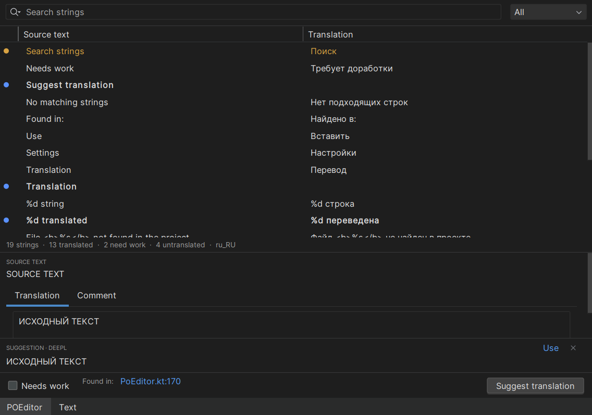

<p align="center">
  
</p>

# POEditor

A lightweight visual editor for gettext `.po` translation files in JetBrains IDEs, inspired by [Poedit](https://poedit.net).
Every `.po` file opens in a dedicated **POEditor** tab; the plain-text tab stays next to it.

Works in all IntelliJ-based IDEs (IntelliJ IDEA, CLion, GoLand, PyCharm, WebStorm, ...), version **2026.2 and newer**.

<p align="center">
  
</p>

## Installation

- **From JetBrains Marketplace** (after the first release): *Settings | Plugins | Marketplace*, search for **POEditor**.
- **From a file**: download `POEditor-<version>.zip`, then *Settings | Plugins | ⚙ | Install Plugin from Disk...* and
  restart the IDE.

## Quick start

1. Open any `.po` file: the **POEditor** tab is selected automatically (the **Text** tab is still there).
2. Pick an entry in the list. The source text, notes, references and the translation fields appear below.
3. Type the translation. It is written into the file as you type, so Undo and `Ctrl+S` work as usual.
4. `Ctrl+Enter` approves the entry and jumps to the next unfinished one.
5. Optional: press **Suggest translation** to see a machine translation under your text, then click **Use** to take it.

The file's `Language:` header decides the target language, so make sure it is set (for example `ru_RU`).

## Features

- Entry list with search, filters (all / needs work / untranslated / translated) and status dots
- Source text, context and notes for translators, plural forms, translator comments
- "Needs work" (fuzzy) flag with Poedit's semantics: editing a translation clears it, un-flagging drops the old `msgid`
- Source references (`#:`) as links that open the code at the right line (absolute and relative paths)
- Edits are written straight into the file, entry by entry, so Undo, VCS diffs and the text tab keep working and
  untouched entries stay byte-identical
- Machine translation suggestions from DeepL and MyMemory (optional, see below)

Not included: `.mo` compilation, `msgfmt` validation, translation memory, spell checking, `.pot` templates and
formats other than PO.

## Keyboard shortcuts

Poedit's defaults (Windows/Linux). All of them can be changed in **Settings | Keymap | POEditor**.

| Action | Shortcut |
|---|---|
| Next / previous translation | Ctrl+Down / Ctrl+Up |
| Next / previous unfinished | Ctrl+Shift+Down / Ctrl+Shift+Up |
| Done and Next | Ctrl+Enter |
| Previously Edited | Ctrl+Shift+Enter |
| Page down / up in the list | Ctrl+PgDn / Ctrl+PgUp |
| Previous / next plural form | Ctrl+Alt+Left / Ctrl+Alt+Right |
| Clear translation | Ctrl+K |
| Copy from source text / from singular | Ctrl+B / Ctrl+Shift+B |
| Translation needs work | Ctrl+U |
| Edit comment | Ctrl+M |
| Find (focus the search field) | Ctrl+F |
| Suggest translation / use the suggestion | Ctrl+T / Ctrl+1 |

## Machine translation

Open **Settings | Tools | POEditor** and pick a service:

- **DeepL**: needs your own API key ([DeepL API Free](https://www.deepl.com/pro-api) includes 500 000 characters per
  month). Placeholders such as `%d`, `%1$s`, `%1%`, `{0}`, `%(name)s` and `${var}` are protected.
- **MyMemory**: works without a key; an optional email raises the free limit from 5 000 to 50 000 characters per day.
  It does not protect placeholders and accepts at most 500 bytes per request.

The **Suggest translation** button shows the suggestion below the translation. Nothing is inserted until you click
**Use**.

### Privacy

The plugin has no telemetry. The text of an entry is sent to the selected service only when you ask for a suggestion.
The DeepL key is stored in the IDE's password safe.

## Building

```
./gradlew buildPlugin
```

By default a matching IntelliJ IDEA is downloaded. To build and verify against an installed IDE instead:

```
./gradlew buildPlugin verifyPlugin -PideDir="C:/Program Files/JetBrains/CLion 2026.2.2"
```

Use the IDE's bundled JBR (Java 25) as `JAVA_HOME`. The archive is written to `build/distributions/`.

Publishing reads its secrets from the environment: `CERTIFICATE_CHAIN`, `PRIVATE_KEY`, `PRIVATE_KEY_PASSWORD` (signing)
and `PUBLISH_TOKEN` (`./gradlew publishPlugin`).

## License

GPL-3.0, see [LICENSE](LICENSE). Not affiliated with Poedit or with the poeditor.com service.
